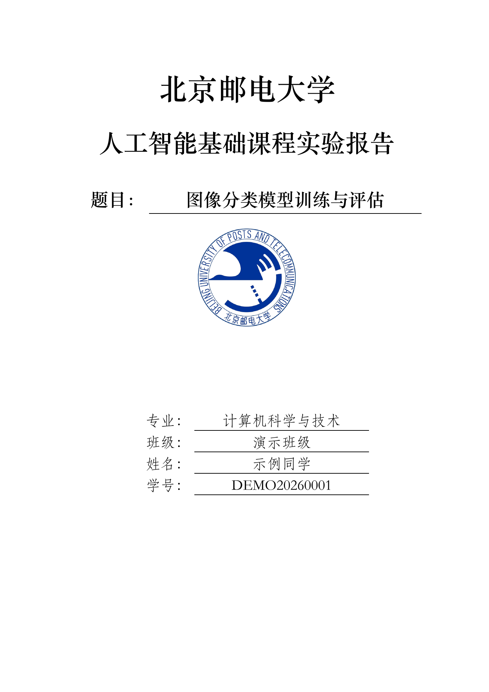
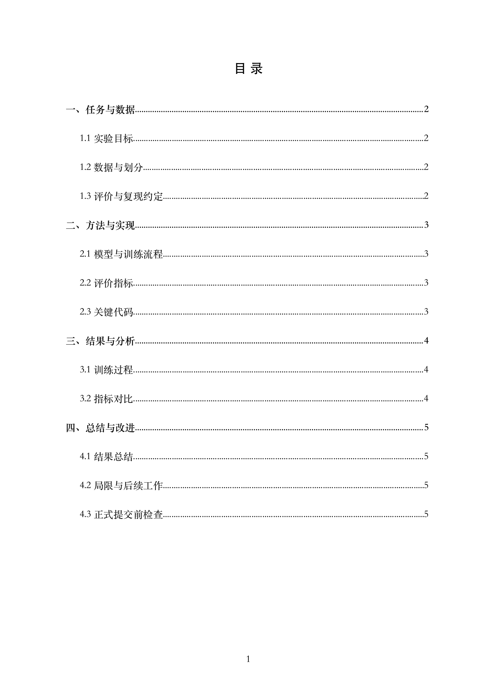
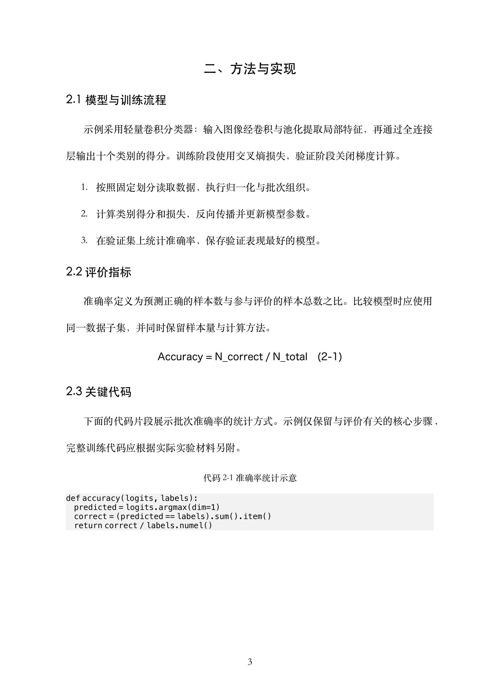
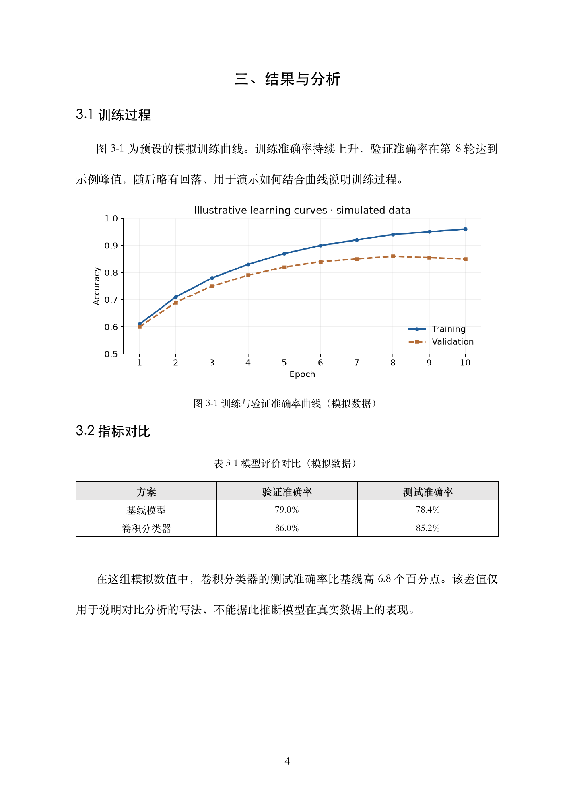

# 北邮课程实验报告 Skill

这是一个供北京邮电大学学生使用的**非官方**课程报告 Skill。它能依据课程要求、教师模板和实验材料，整理内容并生成可编辑的 DOCX。版式来自课程报告样例，不代表学校统一规范；教师要求始终优先。

## 效果预览

先看一份报告长什么样。下面以 **「图像分类模型训练与评估」** 为主题，使用本仓库的生成脚本制作示例，展示封面、目录、正文层级、公式、代码和图表排版。

> 示例仅用于展示版式：姓名、班级、学号及实验数据均为演示内容，不代表真实学生信息或实际实验结果。该版式不是北邮官方统一规范，正式提交以教师要求为准。

### 封面与目录

封面包含校徽、课程名称、实验题目和学生信息；目录按章节与小节组织，带页码。点击图片可查看大图。

<table>
  <tr>
    <td align="center" width="50%"><strong>封面</strong></td>
    <td align="center" width="50%"><strong>目录</strong></td>
  </tr>
  <tr>
    <td><a href="docs/showcase/cover.png"></a></td>
    <td><a href="docs/showcase/contents.png"></a></td>
  </tr>
</table>

### 正文与图表

正文使用分级标题组织内容，支持段落、列表、公式和代码块；图题在图下、表题在表上，图表按章编号。

<table>
  <tr>
    <td align="center" width="50%"><strong>方法与实现 · 标题、公式、代码</strong></td>
    <td align="center" width="50%"><strong>结果与分析 · 曲线、表格、题注</strong></td>
  </tr>
  <tr>
    <td><a href="docs/showcase/method.png"></a></td>
    <td><a href="docs/showcase/results.png"></a></td>
  </tr>
</table>

**查看完整示例：** [PDF 预览](docs/showcase/sample-report.pdf) · [可编辑 DOCX](docs/showcase/sample-report.docx) · [生成输入 JSON](docs/showcase/report.json)

示例采用以下结构，实际使用时会根据实验材料与课程要求调整，不强制套用固定目录：

```text
封面
目录
一、任务与数据
    1.1 实验目标
    1.2 数据与划分
    1.3 评价与复现约定
二、方法与实现
    2.1 模型与训练流程
    2.2 评价指标
    2.3 关键代码
三、结果与分析
    3.1 训练过程
    3.2 指标对比
四、总结与改进
    4.1 结果总结
    4.2 局限与后续工作
    4.3 正式提交前检查
```

预览由 DOCX 渲染得到。预览导出使用 macOS 兼容中文字体，DOCX 保留模板指定的字体；在不同系统与 Word 版本中，字形和分页可能略有差异。示例目录展示已填充的域结果，编辑正文后仍需在 Word 中更新目录和页码域。

## 安装

在 Codex 中让 `$skill-installer` 从本仓库安装 `skills/bupt-lab-report`，或将该目录完整复制到自己的 `~/.agents/skills/`。例如，可以把仓库链接发给 Codex 并说：

> 请用 `$skill-installer` 安装这个 GitHub 仓库中的 `skills/bupt-lab-report` Skill。

安装后可在新对话中使用 `$bupt-lab-report`，并附上课程要求、实验材料和自己的封面信息。普通网页版 ChatGPT 的本地文件访问和 Skill 安装方式可能不同；仓库链接本身不会自动安装 Skill。

## 独立使用生成脚本

在仓库根目录运行：

```bash
python -m pip install -r requirements.txt
python skills/bupt-lab-report/scripts/build_report.py --input examples/demo-report.json --output demo-report.docx
python skills/bupt-lab-report/scripts/validate_report.py demo-report.docx
```

`examples/demo-report.json` 展示输入格式。正式使用时，请把专业、班级、姓名、学号等占位符改为自己的信息，并在 Word 中更新目录和页码域。详见 [生成规格](skills/bupt-lab-report/references/build-spec.md)。

要生成上方的展示报告，可将命令中的输入改为 `docs/showcase/report.json`：

```bash
python skills/bupt-lab-report/scripts/build_report.py --input docs/showcase/report.json --output showcase-report.docx
python skills/bupt-lab-report/scripts/validate_report.py showcase-report.docx
```

生成后请在 Word 中更新目录和页码域。JSON 引用的曲线图片已随展示素材提供，其中数值为模拟数据。

仓库不包含原始学生报告、真实个人信息或其预览图；技能内置 DOCX 仍为空白模板，`docs/showcase/` 仅存放本 README 使用的模拟示例与展示素材。
